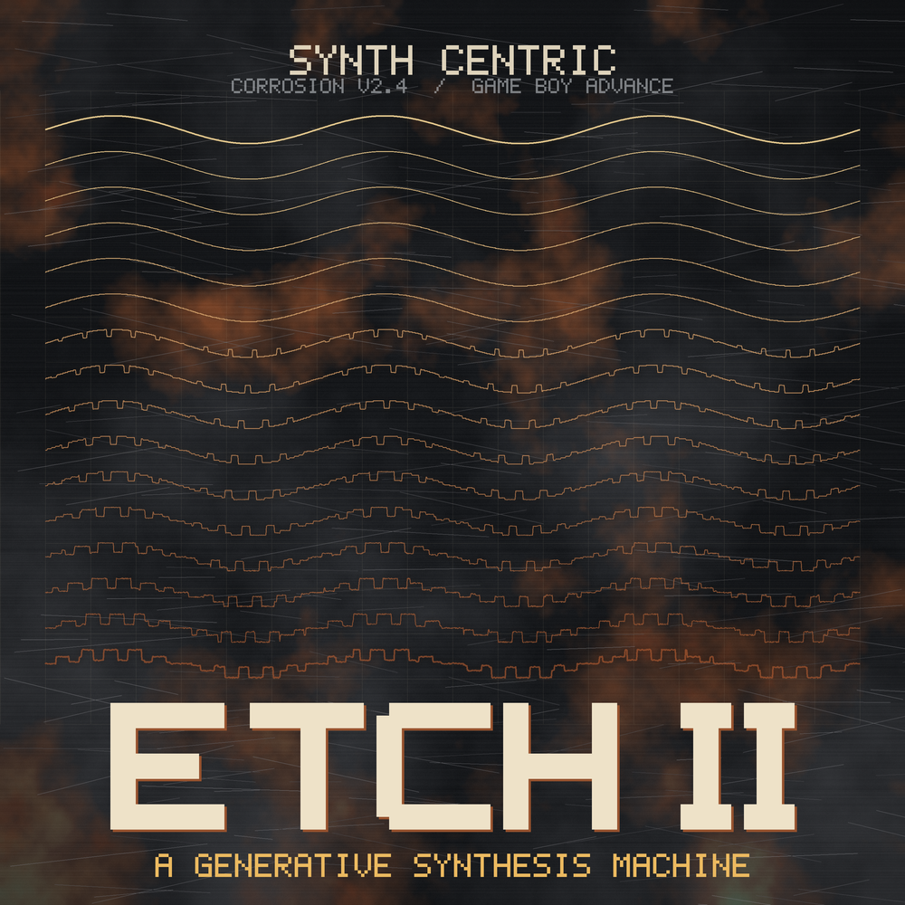

# ETCH II — A Generative Synthesis Machine

**by Synth Centric** · a native Game Boy Advance ROM

> One composition. Two machines. Two sonic interpretations.

ETCH II is a generative electronic music instrument and an eight-piece living album for the Game Boy Advance, and the successor to **ETCH — A Generative Acid Machine** for the Game Boy. Both run the same composer, **CORROSION v2.4** — ETCH II contains ETCH's generator source unchanged — so a 12-digit seed code produces the same groove on both machines. ETCH II plays it through five software synthesizers (subtractive, 2-operator FM, wavetable, phase distortion, Karplus–Strong resonator) and procedural percussion, mixed in real time on the GBA's ARM7.



## Quick start

1. Open `release/ETCH_II_by_Synth_Centric.gba` in mGBA or copy it to a flash cartridge (save type SRAM).
2. Press START. OXIDE plays.
3. **L / R** change screens; on LIVE, hold **A** and press ← → on ENGINE or MODE.

## Contents

| Path | |
|---|---|
| `src/corrosion/legacy/` | CORROSION v2.4, copied unmodified from ETCH 2.5 |
| `src/corrosion/bridge/` | ETCH's evolution scheduling (anchors, entropy, REGEN, FILL, UNDO) + edit epochs |
| `src/expansion/` | ETCH II's separate generator for the LEAD / CHORD / DRONE / TEXTURE tracks |
| `src/audio/` | mixer (Direct Sound DMA, 15 768 Hz), voices, percussion, effects — ARM code in IWRAM |
| `src/sequencer/` | ETCH's step semantics on a sample-accurate clock |
| `src/ui/`, `src/storage/`, `src/instruments/`, `src/main/` | screens, SRAM saves, patches, boot and main loop |
| `tools/` | table / graphics / album / artwork / PDF / release generators, gbafix source |
| `tests/` | compatibility certification, host tests (incl. ETCH's original 44), emulator suite |
| `docs/` | manual, overview, sound engine, CORROSION, compatibility, controls, testing, build, track notes |
| `release/` | the ROM, manual (MD + PDF), documentation, artwork, audio previews, source archive, checksums |

## Build

```bash
make
```

See [`docs/ETCH_II_Build_Instructions.md`](docs/ETCH_II_Build_Instructions.md). Tests: `make hosttest`, `make compat`, `make emutest`.

## Status

- Compatibility with ETCH seed codes: **verified** against ETCH's source and against the released ETCH 2.5 ROM (emulated) — see [`docs/ETCH_COMPATIBILITY_SPEC.md`](docs/ETCH_COMPATIBILITY_SPEC.md).
- Tested in mGBA 0.10.2 only. **Not yet tested on physical Game Boy Advance hardware.**

Licences: code MIT; music, artwork and names © Synth Centric — see `LICENSE` and `THIRD_PARTY_NOTICES.md`.
